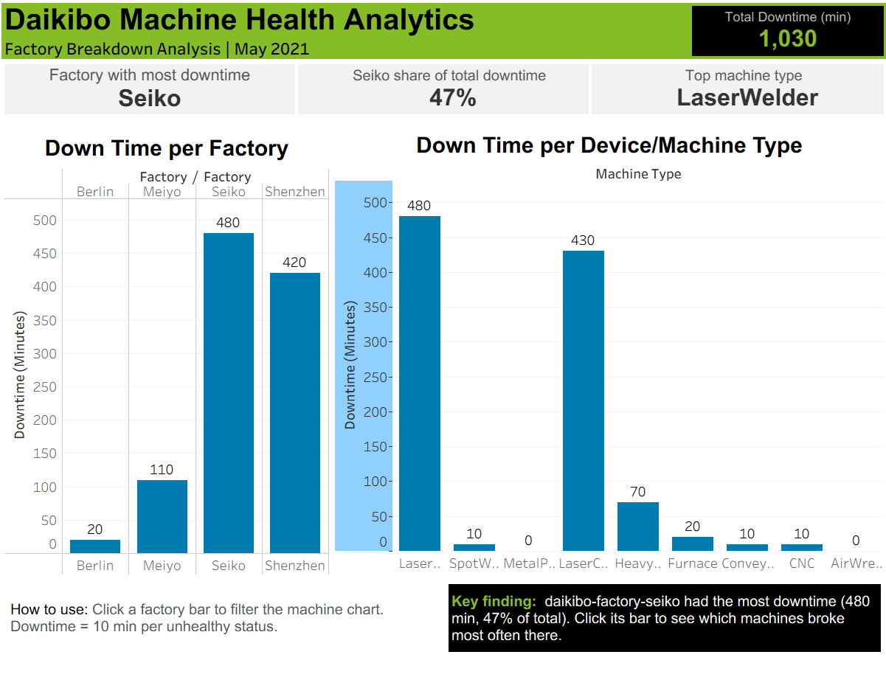
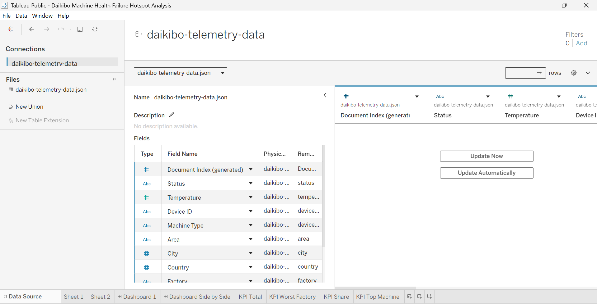
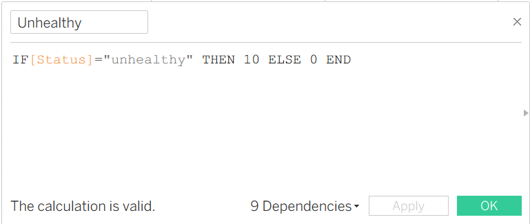
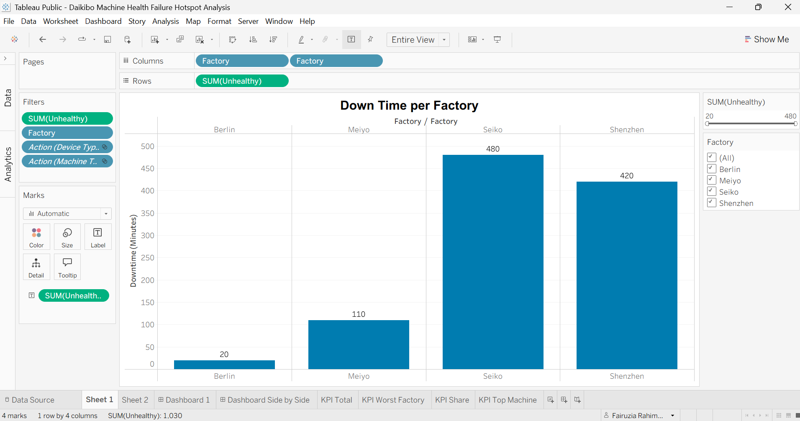
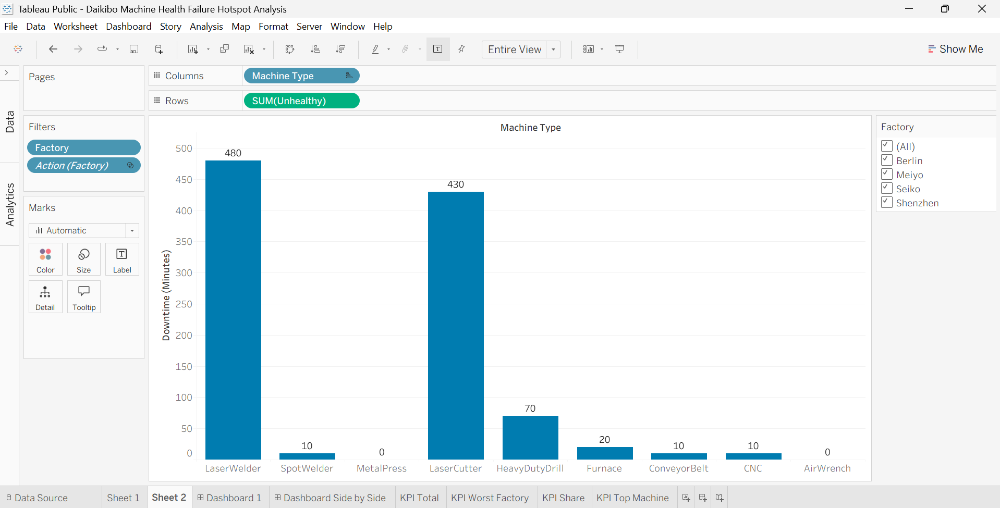
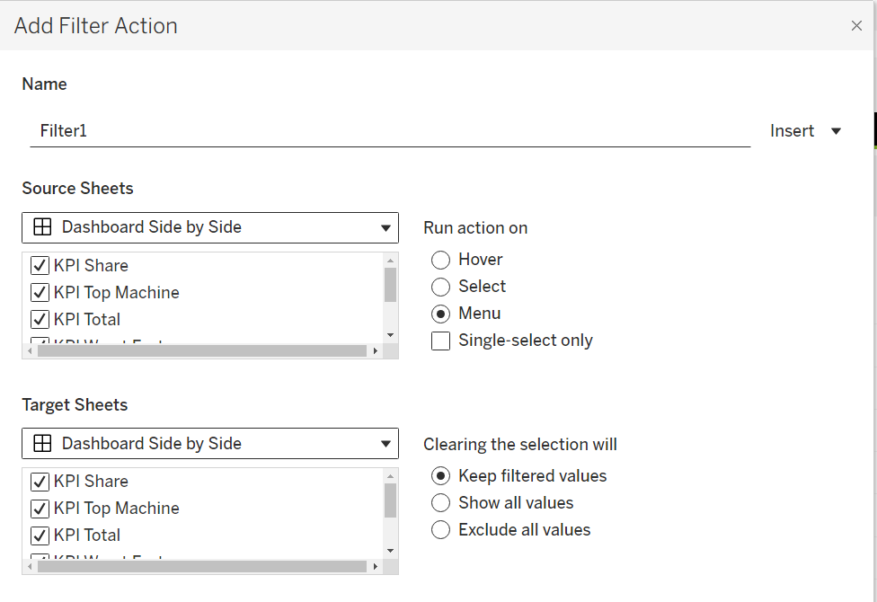
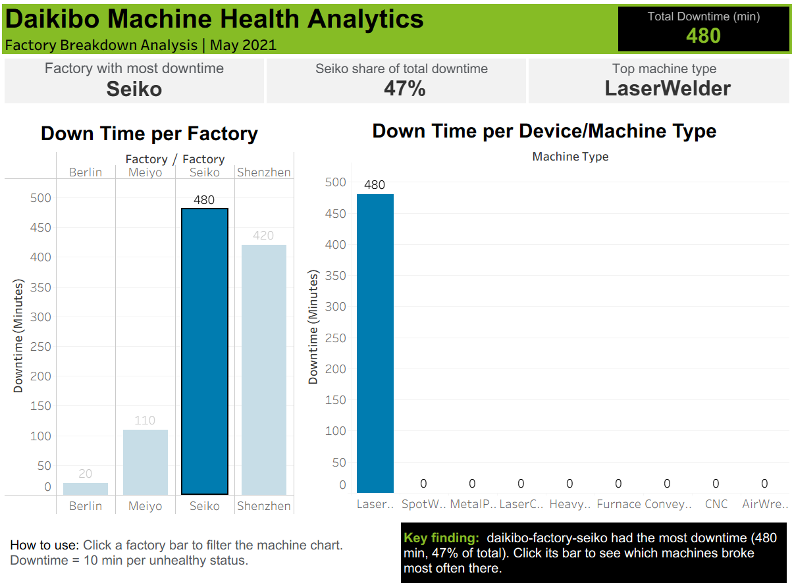
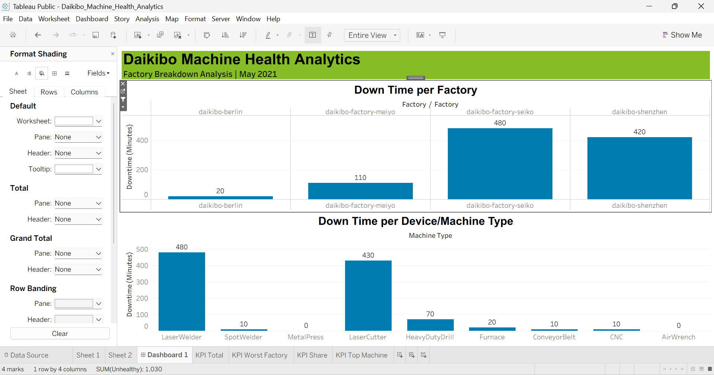

# Daikibo Machine Health : Failure Hotspot Analysis

An interactive Tableau dashboard that finds **where machines break down most** across 4 factories, and **which machines are responsible**, using one month of IoT telemetry data.



**[View the live interactive dashboard on Tableau Public](https://public.tableau.com/views/DaikiboMachineHealthFailureHotspotAnalysis/DashboardSidebySide)**

 -lightgrey)  

## Project Description

- **Role:** Data Analyst (job simulation)
- **Client:** Daikibo (manufacturing client)
- **Program:** Deloitte Australia Data Analytics job simulation, by Forage
- **Dataset:** 1 month (May 2021) of machine telemetry data, 4 factories, 9 machine types at each factories.
- **Tool:** Tableau
- **Project Area:** Business Intelligence, EDA (Exploratory Data Analysis), Data Visualization, Operational / Manufacturing Analytics, IoT Telemtry Analytics.
- **Deliverable:** One-page interactive dashboard with KPI (Key Performance Indicator) cards and a linked drill-down
- **Business questions:** (1) Where do machines break down most? (2) Which machines break down most there?
  
## Results

| Question | Answer |
|:---|:---|
| Total estimated downtime | **1,030 minutes** (103 unhealthy statuses x 10 min) |
| Worst location | **Seiko (Osaka, Japan): 480 min, 47% of total** |
| Worst machine at that location | **LaserWelder: 480 min, 100% of Seiko's downtime** |
| Machine concentration | LaserWelder + LaserCutter = **910 of 1,030 min (88%)** |
| Location concentration | Seiko + Shenzhen = **900 of 1,030 min (87%)** |

## Table of Contents

1. [Business Problem](#1-business-problem)
2. [Dataset](#2-dataset)
3. [Tools and Skills Demonstrated](#3-tools-and-skills-demonstrated)
4. [Approach](#4-approach)
5. [Dashboard Design](#5-dashboard-design)
6. [Findings and Business Insights](#6-findings-and-business-insights)
7. [Recommendations](#7-recommendations)
8. [Assumptions and Limitations](#8-assumptions-and-limitations)
9. [Next Steps](#9-next-steps)
10. [What I Learned](#10-what-i-learned)
11. [Repository Structure](#11-repository-structure)
12. [How to Explore This Project](#12-how-to-explore-this-project)
13. [Acknowledgements](#13-acknowledgements)
14. [Contact](#14-contact)

## 1. Business Problem

Daikibo operates four factories. Its tech team used a data unification algorithm to merge telemetry from all sites into a single JSON file covering **May 2021**. The client collected this data to answer two questions:

1. **In which location did machines break down the most?**
2. **Which machines broke down most often in that location?**

The main goal of this project was to turn the raw telemetry data into a dashboard that answers both questions at a glance, and to back the answers with numbers a maintenance or operations manager can act on.

## 2. Dataset

- **Source:** Client telemetry provided in from the Deloitte Australia Data Analytics Job Simulation with Forage.
- **Format:** Single JSON file with nested fields (all schema levels imported into Tableau)
- **Period:** May 2021 (one month)
- **Reporting frequency:** One status message per machine every 10 minutes
- **Locations (4):**
1. Daikibo Factory Meiyo (Tokyo, Japan)
2. Daikibo Factory Seiko (Osaka, Japan)
3. Daikibo Berlin (Berlin, Germany)
4. Daikibo Shenzhen (Shenzhen, China)
- **Machine types (9 types of machines per location):**
1. LaserWelder
2. SpotWelder
3. MetalPress
4. LaserCutter
5. HeavyDutyDrill
6. Furnace
7. ConveyorBelt
8. CNC
9. AirWrench
- **Rows:** 8,640

**Key fields used**

- `Factory`: Factory identifier (the dashboard displays Berlin, Meiyo, Seiko, Shenzhen via aliases)
- `Machine Type`: One of the 9 machine types previously stated.
- `Status`: Machine health status in each message
- `Timestamp`: The time of each message
- `Device ID`: Unique Machine Identifier
- `Area`, `City`, `Country`, `Section`: location attributes
- `Temperature`: Sensor reading (not used in this analysis and project)

## 3. Tools and Skills Demonstrated

- **Data preparation:** Importing nested JSON in Tableau and selecting all schema levels so every field is available.
- **Data modeling:** Creating a calculated measure that converts status messages into estimated downtime minutes.
- **Visualization:** Used bar charts, KPI cards, data labels, and a consistent color palette that matches the Deloitte colour palette.
- **Interactivity:** A dashboard action that uses the factory chart as a filter for the machine chart, with KPI cards excluded from the filter itself.
- **Advanced Tableau:** Created detailed expressions for the share-of-total KPI, Top N filters, field aliases, and floating and tiled layout containers.
- **Dashboard design:** Z-pattern reading flow, visual hierarchy, as well as spacing and padding control.
- **Business analysis:** Translating findings into business insights and prioritized recommendations.

## 4. Approach

### Step 1: Import the JSON data
Imported the telemetry file into Tableau with **all schema levels selected**, so that the nested fields were flattened into usable columns.



### Step 2: Create the "Unhealthy" calculated measure
Each unhealthy status message represents **10 minutes of potential downtime** since the previous message (messages arrive every 10 minutes).

```
// Replace with the exact formula used in the workbook
IF [Status] = "unhealthy" THEN 10 ELSE 0 END
```

Summing this measure gives estimated downtime in minutes: **1,030 minutes = 103 unhealthy messages x 10 min**.



### Step 3: Build "Down Time per Factory"
A bar chart of `SUM(Unhealthy)` by `Factory`, with data labels, to answer question 1.



### Step 4: Build "Down Time per Device/Machine Type"
A bar chart of `SUM(Unhealthy)` by `Machine Type`, to answer question 2.



### Step 5: Combine into a dashboard with an interactive filter
Placed both sheets on one dashboard and set the factory chart as a filter. Selecting a factory now shows only that factory's machine downtime.



### Step 6: Select the worst factory and read the answer
Clicking the Seiko bar filters the machine chart to Seiko only. Only one machine type shows downtime.



### Step 7: Redesign for faster reading
After the first version answered the questions, I rebuilt the layout around a Z-pattern, added KPI cards, and applied a consistent color palette. The two core bar charts were kept unchanged so the redesign could be compared fairly with the original (see Section 5).

## 5. Dashboard Design

### Before and after

| First version | Final version |
|:---:|:---:|
|  |  |

The first version put two charts on a page. The final version tells the viewer the answer first and lets them verify it in the charts second.

### Z-pattern reading flow


| Point | Position | Content |
|:---:|:---|:---|
| 1 | Top left | Title banner: "Daikibo Machine Health Analytics" |
| 2 | Top right | KPI: Total Downtime = 1,030 min |
| Diagonal | Middle | 3 KPI cards, then the two bar charts |
| 3 | Bottom left | "How to use" guidance |
| 4 | Bottom right | Key finding callout |

### Design decisions

- **Color palette:** Deloitte-inspired: green `#86BC25`, black `#000000`, blue `#0076A8`, grays `#53565A` and `#F2F2F2`. Green marks the banner and highlights, black frames the headline KPI and conclusion, and blue is reserved for the data bars.
- **KPI cards:** three cards answer the two business questions without requiring any interaction.
- **Typography:** Arial throughout, with large numbers for KPIs and small labels for context.
- **Filter safety:** the dashboard action targets only the machine chart, so the KPI cards keep their values when a factory is selected.
- **Layout control:** floating objects with exact x/y/width/height values keep every element aligned.
- **Constraint respected:** the two original bar charts were preserved as built.

## 6. Findings and Business Insights

### 1. Seiko is the downtime hotspot, and two sites dominate

| # | Factory | Downtime (min) | Share of total |
|:---:|:---|:---:|:---:|
| 1 | **Seiko (Osaka)** | **480** | **46.6%** |
| 2 | Shenzhen | 420 | 40.8% |
| 3 | Meiyo (Tokyo) | 110 | 10.7% |
| 4 | Berlin | 20 | 1.9% |
| | **Total** | **1,030** | **100%** |

- Seiko and Shenzhen together account for **900 of 1,030 minutes (87%)**.
- Seiko's downtime is about **24x Berlin's** and **4.4x Meiyo's**.

### 2. Two machine types produce 88% of all downtime

| # | Machine type | Downtime (min) | Share of total |
|:---:|:---|:---:|:---:|
| 1 | LaserWelder | 480 | 46.6% |
| 2 | LaserCutter | 430 | 41.7% |
| 3 | HeavyDutyDrill | 70 | 6.8% |
| 4 | Furnace | 20 | 1.9% |
| 5 | SpotWelder | 10 | 1.0% |
| 6 | ConveyorBelt | 10 | 1.0% |
| 7 | CNC | 10 | 1.0% |
| 8 | MetalPress | 0 | 0% |
| 9 | AirWrench | 0 | 0% |

### 3. At Seiko, the problem is one machine type
When the Seiko bar selected, **LaserWelder shows 480 minutes and the other eight machine types show 0**. That means **100% of Seiko's downtime comes from LaserWelders machine**.

### 4. The LaserWelder problem is specific to Seiko
Company-wide LaserWelder downtime is also 480 minutes, which equals Seiko's total. So LaserWelders at Berlin, Meiyo, and Shenzhen recorded **0 minutes** of downtime. Since all four sites run the same 9 machine types, this points to a **Seiko-specific cause** (equipment batch, maintenance practice, operating conditions) rather than a design flaw in the machine type.

### Answers to the client's questions

1. **Location with the most breakdowns:** Seiko Factory (Osaka, Japan), 480 minutes (47% of total).
2. **Machine that broke most often there:** LaserWelder, 480 minutes (100% of the site's downtime).

## 7. My Recommendations

1. **Investigate Seiko's LaserWelders first.** Review maintenance logs, machine age, operating conditions, and operator procedures. This is the only biggest source of downtime at the single worst site, and it addresses **47%** of total recorded downtime.
2. **Benchmark Seiko against the other three sites.** LaserWelders at the other sites recorded 0 minutes, so working practices that prevent downtime may already exist inside the company. This allows a faster fix by reusing internal best practice.
3. **Investigate LaserCutter downtime, starting with Shenzhen.** LaserCutter accounts for 430 min (42%). [VERIFY: click the Shenzhen bar and confirm which machine drives its 420 minutes, then update this line.] Together with LaserWelder, this addresses **88%** of downtime.
4. **Set up ongoing monitoring of the top two machine types.** Track downtime per machine type per site on a recurring dashboard, which turns a one-time analysis into an early-warning view to analyze their performance.
5. **Deprioritize low-impact machines.** MetalPress and AirWrench show 0 minutes, and SpotWelder, ConveyorBelt, and CNC show 10 minutes each, so maintenance effort should go where the downtime is.

## 8. Assumptions and Limitations

- **Downtime is an estimate.** Each unhealthy message is counted as 10 minutes, based on the 10-minute reporting interval. Real downtime could be shorter or longer.
- **One month of data.** This is a data obtained during a 1 month observation and not seasonal, long-term trends, and recurring patterns type of data.
- **Descriptive, not causal.** The data shows where and which, and not why. The root-cause conclusions require maintenance records and engineering input.
- **No predictive model.** This is an exploratory analysis, not a failure-prediction type of project.
- **Simulated client.** The data comes from a job simulation, so conclusions illustrate method rather than real factory or manufacturing operations.

## 9. Next Steps for Improvements

In the future, if I extended this project, I would do these steps, such as :

1. **Add a time dimension.** Use `Timestamp` to look at downtime by day and hour, and test whether failures cluster in particular shifts or dates.
2. **Drill down to individual devices.** Use `Device ID` to see whether Seiko's LaserWelder downtime comes from one faulty unit or all of them.
3. **Test the temperature link.** Explore whether `Temperature` readings differ between healthy and unhealthy messages. Since during the analysis being done for this project, I didn't include observing or analyzing the temperature data.
4. **Compute reliability metrics.** Add downtime rate (percentage of messages that are unhealthy) so sites with different volumes can be compared fairly.
5. **Build a simple predictive model.** Explore whether temperature and recent status can flag a machine before it becomes unhealthy.

## 10. What I Learned

- How to import nested JSON into Tableau and select the right schema levels
- How to create calculated fields and use LOD (Level of Detail) expressions for share-of-total KPIs
- How to configure dashboard actions so a filter targets only the intended sheets
- How to redesign a dashboard with a Z-pattern so viewers get the answer first and the evidence second
- How floating and tiled objects, padding, and layering work, and why exact positioning keeps a dashboard stable to be observed.
- How to turn raw company dataset into useful business insights / findings and recommendations, as well as answering the client's questions as previously stated and explained in the beginning.

## 11. Repository Structure

```
Daikibo-Machine-Health-Failure-Hotspot-Analysis/
├── README.md
├── LICENSE
├── tableau/
│   └── Daikibo_Machine_Health_Analytics.twbx
├── images/
│   ├── 01-dashboard-final.png
│   ├── 02-dashboard-before.png
│   ├── 03-z-pattern-wireframe.png
│   ├── 04-data-import-schema.png
│   ├── 05-calculated-field-unhealthy.png
│   ├── 06-sheet-downtime-per-factory.png
│   ├── 07-sheet-downtime-per-machine.png
│   ├── 08-dashboard-action-filter.png
│   └── 09-seiko-selected-drilldown.png
└── data/
    └── README.md
```

## 12. How to Explore This Project

**Option A: Explore Online**
Open the [Tableau Public dashboard](YOUR_TABLEAU_PUBLIC_LINK) and click a factory bar to filter the machine chart.

**Option B: Locally**
1. Download `tableau/Daikibo_Machine_Health_Analytics.twbx`.
2. Open it in Tableau Desktop or Tableau Public.
3. Click the **Seiko** bar on the factory chart to reproduce the drill-down.

## 13. Acknowledgements

This project was completed as part of the **Deloitte Australia Data Analytics Job Simulation** on [Forage](https://www.theforage.com/simulations/deloitte-au/data-analytics-s5zy). Daikibo is a fictional client created for the simulation. This repository is an independent portfolio project and is not affiliated with or endorsed by Deloitte or Forage.

## 14. Contact

**Fairuzia Rahimanita**

[LinkedIn](www.linkedin.com/in/fairuzia-rahimanita-0b8a62379) | [Email](mailto:zialuvs3@gmail.com) | [Tableau Public](https://public.tableau.com/app/profile/fairuzia.rahimanita/vizzes)
